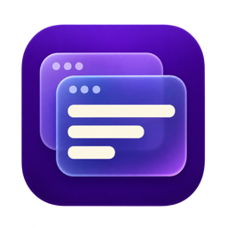

  

<h1 align="center">PerfHUD</h1>

Live system metrics, game FPS, and frame times in a compact macOS overlay.

  <a href="https://github.com/JzM1ckey/PerfHUD/releases/download/v1.8.0/PerfHUD-1.8.zip"><strong>Download PerfHUD 1.8 (34) · Завантажити</strong></a>
  · <a href="#english">English</a>
  · <a href="#українська">Українська</a>

## English

PerfHUD places live performance metrics in a compact, draggable desktop overlay with native SwiftUI Liquid Glass styling.

### Features

- Live CPU, GPU, memory, swap, power, and battery metrics.
- Maximum CPU sensor temperature using generation-specific M1–M6 sensor maps (including Pro, Max, and Ultra), with fan speeds in RPM.
- Game FPS, rolling 10-second min/max, 1% low, and frame-time graph and stats.
- Automatic game detection or manual app lists; FPS from the game window or display.
- HUD controls for size, opacity, color, metrics, and window behavior.
- Liquid Glass Studio settings with system accent colors, live HUD previews, and editable slider percentages.
- Refresh rate, launch at login, temperature units, and English/Ukrainian language.

### Requirements

- macOS 26 or later.
- Apple Silicon recommended for temperature and power metrics.
- Screen Recording permission is needed only for the foreground-game capture source. The display-cadence source does not require it.

### Install

Download `PerfHUD-1.8.zip` from [release v1.8.0](https://github.com/JzM1ckey/PerfHUD/releases/tag/v1.8.0) on the [Releases](https://github.com/JzM1ckey/PerfHUD/releases) page, unzip it, and move `PerfHUD.app` to Applications. If macOS blocks the app, open it from Finder using Control-click → Open.

See [Changelog](CHANGELOG.md) for release history.

### License

PerfHUD is distributed under the [MIT License](LICENSE).

## Українська

**Легкий віджет для macOS із показниками системи та частоти кадрів в іграх.**

PerfHUD показує поточні показники у компактному перетягуваному вікні з нативним оформленням SwiftUI Liquid Glass.

### Можливості

- Показники CPU, GPU, пам’яті, swap, потужності та батареї.
- Максимальна температура серед датчиків CPU за окремими картами M1–M6 (включно з Pro, Max та Ultra) та оберти вентиляторів у RPM.
- Ігровий FPS, мін./макс. за останні 10 секунд, 1% low і графік часу кадру.
- Автовизначення ігор або власний список; FPS із вікна гри чи дисплея.
- Налаштування розміру, прозорості, кольору, показників і поведінки HUD.
- Налаштування Liquid Glass Studio із системним акцентом, переглядом HUD і редагованими відсотками повзунків.
- Інтервал оновлення, запуск під час входу, одиниці температури та мова English/Українська.

### Вимоги

- macOS 26 або новіша.
- Для показників температури та потужності рекомендовано Apple Silicon.
- Дозвіл «Запис екрана» потрібен лише для захоплення активного вікна гри. Джерело за ритмом дисплея його не потребує.

### Встановлення

Завантажте `PerfHUD-1.8.zip` із [релізу v1.8.0](https://github.com/JzM1ckey/PerfHUD/releases/tag/v1.8.0) на сторінці [Releases](https://github.com/JzM1ckey/PerfHUD/releases), розпакуйте архів і перемістіть `PerfHUD.app` до Applications. Якщо macOS блокує застосунок, відкрийте його у Finder через Control-click → Open.

Історія змін — у [Changelog](CHANGELOG.md).

### Ліцензія

PerfHUD поширюється за [ліцензією MIT](LICENSE).
